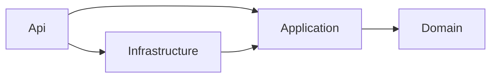

# Smart Expense Tracker

A REST API for tracking personal expenses in any currency. Every expense is converted to EUR using live exchange rates from an external API, and the result is stored with the expense. The API supports categories, filtering and sorting, spending totals, JWT authentication and isolated data per user.

## Features

- **Expenses**: create, read, update and delete expenses with amount, currency, category, date and an optional description.
- **Categories**: create, read, update and delete categories. Names are unique per user.
- **Currency conversion**: every expense is converted to EUR when it is saved. The exchange rate used is stored with the expense, so old expenses never change when the rates change.
- **Filtering and sorting**: filter expenses by date range, category and currency; sort by date, amount or amount in EUR.
- **Reports**: total spending per category, and total spending per day, week or month.
- **Authentication**: users register and log in; the API is protected with JWT bearer tokens. Each user only sees their own data.
- **Caching**: exchange rates are kept in memory, so most requests do not call the external API (see [Exchange rate caching and fallback](#exchange-rate-caching-and-fallback)).
- **External API failures**: if the exchange rate API is slow or down, the last known rates are used. If no rates were ever received, the API answers with `503`.
- **Background refresh**: a background service refreshes the exchange rates every hour.
- **Statistics**: counters about the requests the API served (`GET /api/statistics`).

## Tech stack

| | |
|---|---|
| Runtime | .NET 10, ASP.NET Core (controllers) |
| Database | SQLite with Entity Framework Core 10 (migrations) |
| Authentication | JWT bearer, passwords hashed with ASP.NET Core Identity's `PasswordHasher` |
| Exchange rates | [ExchangeRate-API](https://www.exchangerate-api.com/) |
| API documentation | OpenAPI + Swagger UI |
| Tests | xUnit |

## Getting started

### Prerequisites

- [.NET 10 SDK](https://dotnet.microsoft.com/download)

### Run the API

```bash
dotnet run --project src/SmartExpenseTracker.Api --launch-profile http
```

Then open **http://localhost:5288/swagger**.

In the Development environment the database (a SQLite file, `smartexpensetracker.db`, created next to the API project and ignored by git) is created and migrated automatically when the app starts. No extra setup is needed.

### Run the tests

```bash
dotnet test
```

## Configuration

Settings are in `src/SmartExpenseTracker.Api/appsettings.json`. Any of them can be overridden with environment variables, using `__` instead of `:` (for example `ExchangeRateApi__ApiKey`).

| Setting | Description |
|---|---|
| `ConnectionStrings:Default` | SQLite connection string. Default: `Data Source=smartexpensetracker.db` |
| `ExchangeRateApi:BaseUrl` | Base URL of the exchange rate API |
| `ExchangeRateApi:ApiKey` | API key of the exchange rate API |
| `Jwt:Key` | Secret used to sign tokens (at least 32 characters) |
| `Jwt:Issuer`, `Jwt:Audience` | Issuer and audience written in and checked on every token |
| `Jwt:ExpiryMinutes` | How long a token is valid. Default: 60 |

> **Note:** to keep the project runnable right after cloning, the exchange rate API key and a development JWT key are included in `appsettings.json`. In a real deployment they must be replaced and kept out of the repository (environment variables or a secret store).

## Quick tour

1. Open Swagger and call `POST /api/auth/register` with an email and a password.
2. Call `POST /api/auth/login` and copy the `token` from the response.
3. Click **Authorize** (top right), paste the token and confirm.
4. Create a category with `POST /api/categories`, for example `{ "name": "Food" }`, and note its `id`.
5. Create an expense with `POST /api/expenses`, using that `id` as `categoryId`.
6. Try `GET /api/expenses` with filters, and the two endpoints under `/api/expenses/summary`.

## API reference

All endpoints except register and login require the header `Authorization: Bearer <token>`.

| Method | Path | Description |
|---|---|---|
| POST | `/api/auth/register` | Create an account |
| POST | `/api/auth/login` | Get a JWT token |
| GET | `/api/categories` | List my categories |
| GET | `/api/categories/{id}` | Get one category |
| POST | `/api/categories` | Create a category |
| PUT | `/api/categories/{id}` | Rename a category |
| DELETE | `/api/categories/{id}` | Delete a category (only if it has no expenses) |
| GET | `/api/expenses` | List my expenses, with filters and sorting |
| GET | `/api/expenses/{id}` | Get one expense |
| POST | `/api/expenses` | Create an expense (converted to EUR) |
| PUT | `/api/expenses/{id}` | Update an expense |
| DELETE | `/api/expenses/{id}` | Delete an expense |
| GET | `/api/expenses/summary/by-category` | Total spending per category |
| GET | `/api/expenses/summary/by-period` | Total spending per day, week or month |
| GET | `/api/exchange-rates` | Latest exchange rates |
| GET | `/api/exchange-rates/convert` | Convert an amount to EUR |
| GET | `/api/statistics` | Request statistics |

### Authentication

**Register**: `POST /api/auth/register`

```json
{ "email": "jane@example.com", "password": "Secret123!" }
```

The password must have 8 to 100 characters. Response `201`:

```json
{ "id": 1, "email": "jane@example.com" }
```

**Login**: `POST /api/auth/login` with the same body. Response `200`:

```json
{ "token": "eyJhbGciOi..." }
```

Wrong email or wrong password both give the same `401` answer.

### Categories

**Create or rename**: `POST /api/categories` and `PUT /api/categories/{id}`

```json
{ "name": "Food" }
```

The name is required, at most 100 characters, and unique per user (case-insensitive). Response (`201` on create, `200` on update):

```json
{ "id": 1, "name": "Food" }
```

A category that belongs to another user is reported as `404`. Deleting a category that still has expenses gives `409`.

### Expenses

**Create or update**: `POST /api/expenses` and `PUT /api/expenses/{id}`

```json
{
  "amount": 45.20,
  "currency": "USD",
  "date": "2026-11-08",
  "description": "Lunch",
  "categoryId": 1
}
```

| Field | Rules |
|---|---|
| `amount` | Required, between 0.01 and 1,000,000,000 |
| `currency` | Required, a 3-letter code such as `USD` (upper or lower case). Unsupported codes give `400` |
| `date` | Optional, format `yyyy-MM-dd`. On create, today's date is used when missing. On update, the current date is kept |
| `description` | Optional, up to 500 characters. An empty or blank text is stored as no description |
| `categoryId` | Required, must be one of your own categories (otherwise `400`) |

Response (`201` on create, `200` on update):

```json
{
  "id": 12,
  "amount": 45.20,
  "currency": "USD",
  "date": "2026-11-08",
  "description": "Lunch",
  "exchangeRate": 0.89581654,
  "amountInEur": 40.49,
  "categoryId": 1,
  "categoryName": "Food"
}
```

`exchangeRate` is how many EUR one unit of the currency was worth when the expense was saved. On update, the expense is converted again only if the amount or the currency changed.

**List**: `GET /api/expenses`. All parameters are optional.

| Parameter | Description |
|---|---|
| `categoryId` | Only expenses of this category |
| `currency` | Only expenses in this currency, for example `usd` |
| `from`, `to` | Date range, `yyyy-MM-dd`, both days included |
| `sortBy` | `Date` (default), `Amount` or `AmountInEur` |
| `sortDirection` | `Desc` (default) or `Asc` |

Example: `GET /api/expenses?currency=USD&from=2026-09-01&to=2026-10-31&sortBy=AmountInEur&sortDirection=Desc`

The response is a list of expense objects like the one above.

### Reports

Both endpoints accept the optional `from` and `to` dates (`yyyy-MM-dd`) and use the amounts in EUR, so expenses in different currencies can be added together.

**Per category**: `GET /api/expenses/summary/by-category`, biggest total first:

```json
[
  { "categoryId": 5, "categoryName": "Travel", "count": 3, "totalEur": 622.97 },
  { "categoryId": 1, "categoryName": "Food", "count": 7, "totalEur": 282.23 }
]
```

**Per period**: `GET /api/expenses/summary/by-period?period=Week`

`period` is `Day`, `Week` or `Month` (default). `periodStart` is the day itself, the Monday of the week, or the first day of the month. The list is in date order.

```json
[
  { "periodStart": "2026-10-05", "count": 3, "totalEur": 85.43 },
  { "periodStart": "2026-11-02", "count": 1, "totalEur": 30.00 }
]
```

### Exchange rates

`GET /api/exchange-rates` returns how many units of each currency equal 1 EUR:

```json
{ "EUR": 1, "USD": 1.1163, "GBP": 0.8342 }
```

`GET /api/exchange-rates/convert?amount=100&currency=USD` returns:

```json
{ "amountInEur": 89.58, "exchangeRate": 0.89581654 }
```

### Statistics

`GET /api/statistics` returns counters kept in memory since the app started (they start again from zero when the app restarts). Requests for the Swagger page are not counted.

```json
{
  "since": "2026-11-09T09:00:00Z",
  "totalRequests": 120,
  "byStatus": { "2xx": 100, "4xx": 18, "5xx": 2 },
  "endpoints": [
    { "endpoint": "GET api/expenses", "count": 30, "averageMs": 4.2 }
  ],
  "exchangeRates": { "cacheHits": 50, "providerCalls": 2, "providerFailures": 0, "fallbackUses": 0 }
}
```

Endpoints are listed by their route pattern (for example `GET api/expenses/{id:int}`), and requests that match no endpoint are counted as `unmatched`.

The `exchangeRates` block describes how the exchange rates were obtained:

| Counter | Meaning |
|---|---|
| `cacheHits` | Times the rates were answered from memory, without calling the exchange rate API |
| `providerCalls` | Calls made to the exchange rate API (by the background refresh or by a request) |
| `providerFailures` | Calls to the exchange rate API that failed |
| `fallbackUses` | Times the last known rates were used because the API failed |

### Errors

Errors follow the standard problem details format:

```json
{ "title": "Conflict", "status": 409, "detail": "You already have a category named 'Food'." }
```

| Status | When |
|---|---|
| `400` | Invalid input (for example a missing field, an unsupported currency, `from` after `to`) |
| `401` | Missing, invalid or expired token, or wrong login details |
| `404` | The resource does not exist, or belongs to another user |
| `409` | Conflict with existing data (duplicate email or category name, deleting a category that has expenses) |
| `500` | Unexpected error. The message is hidden from the client and logged on the server |
| `503` | The exchange rates are not available and there are no earlier rates to use |

Validation errors of the request body or the query string (a missing field, an invalid value) come in the standard ASP.NET Core validation format, with an `errors` object that lists each field.

## Exchange rate caching and fallback

The exchange rates change only once a day, so the API does not ask the external service for every request. The rates are kept in memory in two copies:

| Copy | Lifetime | Purpose |
|---|---|---|
| Rates | 1 hour and 5 minutes | Answers every request that needs a rate |
| Backup (last known rates) | Never expires | Used only when the external API fails |

**How the rates are refreshed**

- **Background refresh:** when the app starts, and then every hour, a background service asks the external API and replaces both copies. The rates last 5 minutes longer than the refresh interval, so they do not expire between two refreshes.
- **On demand:** if a request needs a rate and the rates are not in memory (for example right after a failed refresh), that request asks the API itself. When many requests arrive at the same time, only one of them calls the API. The others wait for it and use its result.
- **Euros** never need a rate.
- Each expense stores the rate it was converted with, so a refresh never changes an existing expense.

**When the external API fails**

| Situation | What happens |
|---|---|
| The API does not answer | The call is stopped after 10 seconds |
| A background refresh fails | A warning is written to the log, the app keeps running and the saved rates stay. The next attempt is one hour later |
| A request needs rates and the API fails, and there is a backup | The backup is used. It is also kept as the current rates for 1 minute, so the next requests do not call a failing API. After that minute, one request tries the API again |
| A request needs rates and the API fails, and there is no backup (the API has never answered since the app started) | The request gets `503` |

The counters of `GET /api/statistics` show all of this: how often the rates were answered from memory, how many calls were made to the API, how many failed and how often the backup was used.

## Architecture



| Project | Responsibility |
|---|---|
| `SmartExpenseTracker.Domain` | Entities: `User`, `Category`, `Expense` |
| `SmartExpenseTracker.Application` | The business rules: services, interfaces, DTOs, mappers and the exceptions used for errors |
| `SmartExpenseTracker.Infrastructure` | Database access (EF Core, repositories), the exchange rate API client and token generation |
| `SmartExpenseTracker.Api` | Controllers, request models, middleware, background service and startup |
| `SmartExpenseTracker.Tests` | Unit tests |

Main decisions:

- **Services hold the rules, repositories only talk to the database.** The services depend on interfaces, so the tests replace the repositories with simple fakes.
- **Data isolation:** the user id always comes from the JWT, never from the request. Every query filters by that id first, and a resource of another user is answered with `404`.
- **One error type:** services throw `AppException` with an `ErrorType` (`Validation`, `NotFound`, `Conflict`, `Unauthorized`), and a single middleware turns it into the right HTTP status.
- **Exchange rate provider behind an interface:** `IExchangeRateProvider` hides the external API. Another provider can be added by writing a new implementation.
- **Money uses `decimal`** and dates use `DateOnly`, since an expense happens on a day and not at a moment in time.
- **Totals are calculated in the service** and not in SQL, because SQLite has no real decimal type.

## Tests

```bash
dotnet test
```

The unit tests cover:

- the business rules of expenses, categories and authentication (validation, conversion, data of other users, duplicates)
- the currency conversion and the behaviour when the exchange rate API fails
- filtering and sorting, run against a real SQLite database in memory
- the totals per category and per period
- the error handling middleware and the request statistics
- JWT token creation and the background refresh of the exchange rates

## Notes and limitations

- "Today" (the default date of a new expense) is the date on the server.
- The request statistics are kept in memory and start from zero when the app restarts.
- The keys in `appsettings.json` are for development only (see Configuration).
